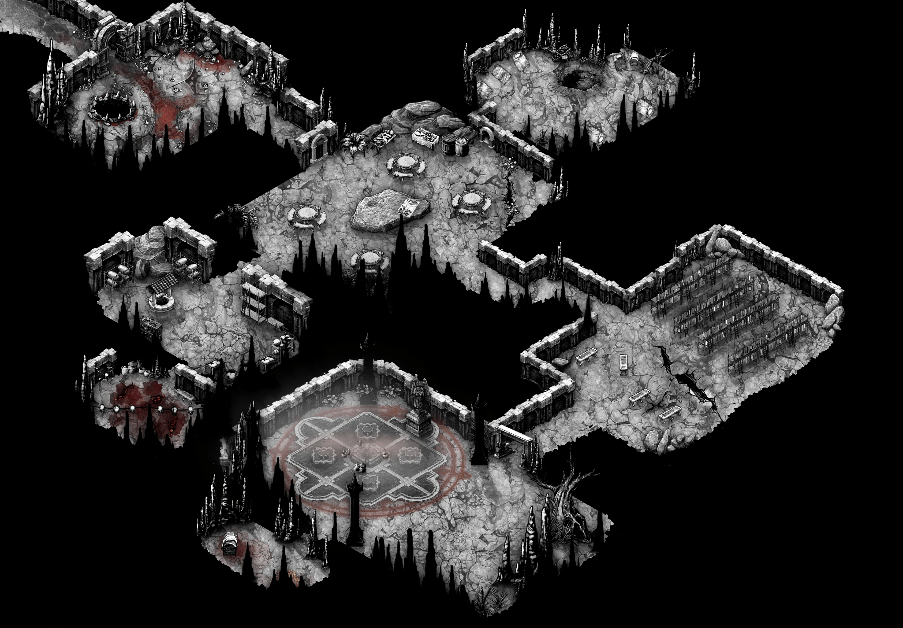

# Novo Testamento de Schleswig

## Capítulo 1: Entrando em Cena

#### Descrição da Cena

Um bando de cães de guerra anda pelas ruelas da miserável cidade de Schleswig.
À sua volta, a gentalha ri, tropeça e amaldiçoa, tudo enquanto vira garrafas de goró.
Entre eles, estão vocês: penitentes que respiram este ar pútrido sabendo que a qualquer momento as sete misérias os levarão ao fim.

>[!NOTE]
> Apresentação dos personagens. Descrição de aparência e ações na cena.

Um homem maltrajado jogado ao chão lhes sorri com seus últimos três dentes podres.
Seus cacos perfurados assoviam na direção de vocês.\
Mas a melodia logo acaba quando seus lábios secos começam a se mexer, moldando súplicas.

#### Diálogo

_"Oh honrados mercenários. Verhu ouviu meus lamentos e os trouxe até mim! Louvado seja."_\
_"Vejam meus senhores, como podem observar, estou infectado pela peste. Peguei dormindo aqui, sobre a grade do bueiro. Tornei-me um moribundo."_\
_"Entretanto, não desisti da vida, não mesmo! Desejo aproveitar meus últimos dias neste chiqueiro."_\
_"Por isso estou aqui a pedir-lhes esmola. Só um trago para tirar-me desta miséria!"_\
_"Teriam algum dinheiro para oferecer a este maldito penitente?"_

> [!WARNING]
> 1. Quem derramar o sangue do mendigo testa Robustez **DR10**. Se falhar, fica infectado: **não recupera HP descansando e perde d6 HP por dia até ser tratado.** Qualquer curandeiro de Schleswig trata a peste por d10 moedas de prata.
> 2. Não atender as necessidades do mendigo somente desencadeará a entrega da mensagem de Enblick.
> 3. Ao receber esmola ou bebida, ele os avisará sobre o que lhes espera à frente: _"Ah, e... um conselho de graça, para retribuir a sua generosidade: Cuidado com a besta à porta. Ela morde."_

_"Ah sim! Lembrei-me de uma coisa, sim."_\
_"Enblick, líder dos ladrões, me incumbiu de entregar uma mensagem"._\
_"Precisa falar com vocês urgentemente. Há um trabalho à sua espera"._\
_"Espera-os na Porta Vermelha."_

>[!NOTE]
> O sem-teto senil não oferecerá direções de imediato, deverá ser perguntado.

_"Sigam a rua Storgatan, dobrem à esquerda na rua Kyrkgatan."_\
_"Em seguida, entrem à direita na Råttgränd, que dará para a viela Tiggargränd. Ao fim encontrarão a Porta Vermelha."_\
_"Somente anunciem o nome de seu bando, já foram avisados."_

>[!WARNING]
> Um jogador rola **d6**. Se alguém anotou ou repetiu as direções em voz alta, **+1** na rolagem.

| d6 | O que acontece |
|----|----------------|
| 1-2 | **Perdidos.** A viela termina num beco sem saída. Três ratos de rua decidem que o bando parece rico. |
| 3-4 | **O chão respira.** Chegam pelo caminho certo, mas um bueiro solta um bafo morno de cheiro doce. Ao lado, um cachorro magro lambe a grade e não para. |
| 5-6 | **Chegam antes da hora.** Do fim da viela, veem Hulda fazendo malabares com a faca sem que ela os perceba. |

#### Descrição da Cena

Ao fim do trajeto, vocês se deparam com uma porta vermelha, de madeira apodrecida.\
Escorada na parede musgosa ao lado, uma mulher de aparência grotesca, fazendo malabares com uma faca.\

...

Ao vê-los, a mulher se desequilibra, deixando a faca cair aos seus pés descalços, penetrando o dorso de seu pé.\
Ela se agacha rapidamente em um grito de dor, encarando-os enquanto desce.\
Arranca a faca sem dó de seu pé hemorrágico, no qual faltam dois dedos, e se levanta lentamente enquanto seca as gotas da lâmina com sua longa língua pálida.

#### Diálogo

_"E aí? Por que vocês, um bando de imbecis, estão aí a me encarar?"_\
_"Também buscam provar da ponta da minha faca?"_\
_"Não lhes bastou ver o sangue de meu pé, querem ver a cor das minhas entranhas?"_

...

_"Malditos jumentos! Por que não falaram assim que chegaram?"_\
_"Entrem logo, antes que eu me canse da cara enrugada de vocês."_

#### Descrição da Cena

A mulher medonha leva sua mão ossuda para o puxador.\
Aplicando toda a sua força em seus dedos ensebados, faz a porta ranger até abrir.\
Gemendo de maneira chorosa, ela bate seu pé sangrento contra o chão repetidas vezes, em uma tentativa de afastar a dor.\
O sangue voa e colore as partes em que a podridão descascou a porta, agora um pouco mais avermelhada.

...

#### Descrição da Cena

A porta dá para uma escada que desce, escorregadia de gordura e mijo.\
Lá embaixo, um antigo matadouro. Os ganchos de carne ainda pendem do teto, agora carregados de casacos roubados, bolsas e um ou outro dono.\
Em volta de um barril, ladrões jogam dados de osso, apostando dedos.\
No fundo, afundada numa banheira de cobre cheia de moedas, Enblick.\
No lugar do olho que falta, uma moeda de ouro cravada na órbita. A peça mais valiosa do salão.

>[!NOTE]
> 1. 6 ladrões no salão, 2 sempre de olho na porta.
> 3. Quem encarar a moeda no olho dela por tempo demais vai ouvir: _"Gostou? Tem mais de onde essa saiu. Basta trabalhar."_

#### Diálogo

_"E então os cães finalmente decidem vir à toca. Enblick esteve à sua espera, ansiosa."_\
_"Enblick já quase se levantara para apaziguar o aborrecimento que a demora de vocês causou."_\
_"Pensava ela em picotar mais alguns dos dedos de Hulda."_

#### Descrição da Cena

Hulda, que desceu atrás de vocês, esconde o pé ferido atrás da canela.

#### Diálogo

...

_"Ah sim, um trabalho, sim. Enblick tem um servicinho para vocês, somente para os melhores."_\
_"Enblick enviou cinco de seus homens para a empreitada, nenhum dos idiotas voltou com o prometido. Na verdade, não voltaram, morreram lá mesmo."_\
_"Enblick anda achando que está abrigando um bando de vagabundos incompetentes, isso a enfurece!"_

>[!IMPORTANT]
>Ao exclamar esse último desabafo, Enblick, furiosa, agarra um martelo de abate jogado aos pés de sua banheira e o arremessa contra um dos bandidos que jogava dados.\
>O martelo gira uma vez no ar e encontra a têmpora do homem com um estalo úmido, como uma noz partida dentro de um saco molhado.\
>O crânio cede para dentro. Um dos olhos salta da órbita e fica pendurado no rosto.\
>Por um instante ele continua sentado, os dados ainda na mão, a boca aberta numa pergunta que nunca termina.\
>Então tomba sobre o barril. Do buraco na cabeça escorre um caldo grosso e acinzentado, misturado ao sangue, que se espalha pela madeira e encharca os dados de osso.\
>O ladrão morre na hora. Aquele que estava à sua frente puxa para si os dedos que o morto tinha apostado, e o próximo rola os dados.

#### Diálogo

_"Enblick paga bem, 50 moedas de prata para cada. O que acham?"_\
_"Os detalhes vêm depois do pacto."_

>[!NOTE]
> Se forem capazes de fazê-la desembuchar, ela lhes dará uma breve sinopse da missão.

_"Enblick dirá apenas isso: escondidos no esgoto, algumas relíquias e alguns mortos. O resto, só depois de apertarem a mão dela."_

> [!WARNING]
> Um jogador pode tentar pechinchar com um teste de Presença DR12. Sucesso: Enblick sobe para 100 moedas de prata cada.\
> Quem quiser mais pode arriscar um segundo teste, DR14. Sucesso: 150 moedas de prata cada.\
> Falha em qualquer teste: Enblick baixa a oferta para 40 moedas de prata e não aceita mais negociar. _"Enblick não gosta de gente gananciosa. Gente gananciosa vira dedo na mesa de dados."_

#### Diálogo
_"Pois bem. Agora que estamos acertados, Enblick lhes contará."_\
_"Debaixo dos nossos pés, nos esgotos, rastejando como ratos, vive um culto herege conhecido como a Igreja Ortodoxa"._\
_"São lunáticos que acreditam num único Deus, guiados pelos ensinamentos de um profeta desmiolado nascido há mais de mil anos"._\
_"Eles são selvagens ritualísticos, muito perigosos. Suas relíquias são ainda piores. Enblick as quer"._\
_"Dizem que fazem milagres. Milagre vende bem."_

...

_"Hulda os levará até o portão do esgoto mais próximo de onde os hereges se escondem"._\
_"Não tem mapa. Não tem marcação. Só duas coisas servem de guia: a parte velha e o fedor doce"._\
_"Quando a água baixar estarão perto."_

## Capítulo 2: Os Túneis do Pecado

#### Descrição da Cena

Hulda, mancando, os conduz para fora da porta vermelha. Nenhuma palavra durante o caminho, somente um sorriso evidentemente forçado e um gesto com sua mão asquerosa.\
Sob sua tutela, a travessia pelos becos de Schleswig torna-se rápida. Essa cobra já se esgueirou muito por aí.\
Com a igreja dos Basiliscos no horizonte próximo, vocês descem uma rua muito estreita e se deparam com um portão de barras de ferro enferrujadas.\
Por entre as barras, sobe o fedor de sempre: merda, água parada, alguma coisa morta.\
Ela estende uma chave para aquele mais próximo dela.

#### Diálogo
_"A chave está aqui. Tem uma lamparina e uma pederneira ali no canto."_\
_"Divirtam-se."_

>[!WARNING]
> A partir daqui, os jogadores estarão trafegando os túneis que levam à masmorra.\
>A locomoção pelos túneis será feita por meio de tabelas, promovendo suspense. Após 3 avanços, encontrarão os "**Túneis do Pecado**".

#### Descrição da Cena

O portão geme ao abrir. Degraus de pedra, cobertos de limo, descem para dentro da escuridão.\
Lá embaixo, a água bate na canela. Fria, grossa, e algo nela se move ao redor dos tornozelos de vocês.\
A luz da lamparina alcança três passos à frente. Depois disso, o túnel se divide em dois.

>[!NOTE]
> 1. A cada bifurcação, um jogador rola **d6**.
> 2. **+1** na rolagem se o bando tiver o **meio mapa**, ou se reconhecer pelo próprio desenho uma bifurcação onde já errou e escolher o outro lado. Os bônus não se somam.
> 3. **[GM]** A lamparina tem óleo para **12 bifurcações**. Depois disso, só a pederneira, e a escuridão.

#### O Labirinto

| d6 | O que acontece |
|----|----------------|
| 1-2 | **Errado.** Role na tabela de ameaças. |
| 3-4 | **Em círculos.** Nenhum avanço. Uma marca de mão na parede que eles juram já ter visto. |
| 5-6 | **Avanço.** Veja a tabela de progresso. |

#### Progresso

| Avanço | O que muda |
|--------|------------|
| 1º | Por baixo do fedor de sempre, algo diferente. Doce, quase agradável. |
| 2º | O doce fica forte. Nas paredes, marcas de mãos em sangue seco, todas do mesmo tamanho. |
| 3º | A água baixa até sumir. As paredes viram pedra trabalhada, mais velha que a cidade. Ao longe, cânticos. |

#### Ameaças nos Túneis

>[!NOTE]
> Cada ameaça acontece **uma única vez**. Depois de usada, o resultado vira o evento da coluna ao lado.

| d6 | Ameaça | Depois de usada |
|----|--------|-----------------|
| 1-2 | **Ratazanas.** Um enxame de ratazanas gordas demais para um esgoto. Algo as alimenta bem. | Uma ratazana boia de barriga para cima, roída pelas outras. |
| 3-4 | **Homens de Enblick**, um para cada dois jogadores. Mortos, inchados de água, ainda de pé. | Uma bota sozinha na água. Dentro dela, ainda um pé. |
| 5-6 | **Algo na água.** Nunca aparece até atacar. Só se sente passando entre as pernas. | Algo liso roça uma perna e some. Ninguém mais o vê. |

>[!NOTE]
> **Ratazanas** HP 6 · Moral 9 · Mordida d4\
> Quem for mordido testa Robustez **DR10**. Se falhar, pega a mesma peste do mendigo.
>
> **Homem de Enblick** HP 8 · Moral - · Couro surrado -d2 · Faca enferrujada d4\
> Não fogem. Neste mundo, os mortos não descansam.\
> Um deles carrega o **meio mapa**.
>
> **Lampreia de esgoto** HP 6 · Moral 8 · Mordida d4\
> Para atravessar o trecho, o bando testa Agilidade **DR12**. Quem falhar sente algo liso se enroscar no tornozelo, e então a mordida.\
> Depois de morder, fica grudada na perna da vítima e pode ser atacada normalmente.\
> Enquanto grudada, suga d2 HP por rodada. Arrancá-la exige Força **DR10** e deixa uma ferida redonda, perfeita, cheia de pequenos furos.\
> Com metade do HP ou menos, teste de Moral: se falhar, solta e some na água escura.

>[!WARNING]
> Ao terceiro avanço, os jogadores chegam aos **Túneis do Pecado**. Daqui em diante, a exploração segue o mapa.

<table>
<tr>
<td></td>
<td></td>
</tr>

<tr><th colspan="2" align="left">1. Ossuário de Boas-Vindas</th></tr>
<tr>
<td valign="top">

**Leitura**

Os jogadores adentram uma caverna de calcário, úmida e umbrosa.\
O cheiro familiar de amônia e sangue de Schleswig invade seus narizes, todavia, 
agora carregado com uma catinga terrível de carne pútrida e tutano rançoso.

A luz da lamparina morre a poucos passos, mas o eco dos seus passos demora a voltar.\
Antes da escuridão, pouco se pôde ver: Ossos humanos dispersos por todo o chão, de diferentes tamanhos e idades.\
Mais à frente, um fosso espinhento. De lá de dentro, um estalo úmido. Depois outro.

</td>
<td valign="top">

**Mestre**
- **Perigo:** Esqueleto Encharcado de Sangue, na fossa de espinhos.
- **Segredo:** Broche de família na poça de sangue (Presença DR12).
- **Loot:**
- **Saídas:** Refeitório.

</td>
</tr>

<tr><th colspan="2" align="left">2. Refeitório Comunal</th></tr>
<tr>
<td valign="top">

**Leitura**

(os fiéis no meio da refeição; pouca coisa na mesa, muita carne)

</td>
<td valign="top">

**Mestre**
- **Cena:** pai e filho. _"Sua mãe está esperando. Deixe-me falar com esses aventureiros."_
- **Pista:** de onde vem tanta comida?
- **Loot:**
- **Saídas:** Ossuário, Cozinha, Dormitório, Biblioteca.

</td>
</tr>

<tr><th colspan="2" align="left">3. Cozinha</th></tr>
<tr>
<td valign="top">

**Leitura**

(...)

</td>
<td valign="top">

**Mestre**
- **Pista:**
- **Loot:**
- **Saídas:** Refeitório, Dispensa.

</td>
</tr>

<tr><th colspan="2" align="left">4. Dispensa Canibal</th></tr>
<tr>
<td valign="top">

**Leitura**

(os que negaram, de cabeça para baixo, coroados de arame, nome na tábua)

</td>
<td valign="top">

**Mestre**
- **Revelação:** os fiéis comem os que duvidaram.
- **Loot:**
- **Saídas:** Cozinha, Ossuário (passagem secreta).

</td>
</tr>

<tr><th colspan="2" align="left">5. Dormitório dos Fiéis</th></tr>
<tr>
<td valign="top">

**Leitura**

(...)

</td>
<td valign="top">

**Mestre**
- **Segredo:**
- **Loot:** baú ao lado da cama, item raro da tabela do livro.
- **Saídas:** Refeitório.

</td>
</tr>

<tr><th colspan="2" align="left">6. Biblioteca Profana</th></tr>
<tr>
<td valign="top">

**Leitura**

(...)

</td>
<td valign="top">

**Mestre**
- **Segredo:**
- **Loot:** pergaminhos escondidos.
- **Saídas:** Refeitório, Altar.

</td>
</tr>

<tr><th colspan="2" align="left">7. Altar de Sacrifício</th></tr>
<tr>
<td valign="top">

**Leitura**

(as mães, as lâminas encostadas nas gargantas, o Helgonfar sobre a fonte)

</td>
<td valign="top">

**Mestre**
- **Relógio:** a partir da iniciativa, uma criança por rodada.
- **Campeão:** come um pedaço do Pastor. _"Tomai e comei. Você não morrerá."_
- **Fim do rito:** a última criança solta a Miséria.
- **Loot:** os pedaços do Pastor.
- **Saídas:** Biblioteca, Sacristia.

</td>
</tr>

<tr><th colspan="2" align="left">8. Sacristia Profana</th></tr>
<tr>
<td valign="top">

**Leitura**

(...)

</td>
<td valign="top">

**Mestre**
- **Segredo:**
- **Loot:** o baú.
- **Saídas:** Altar.

</td>
</tr>
</table>
